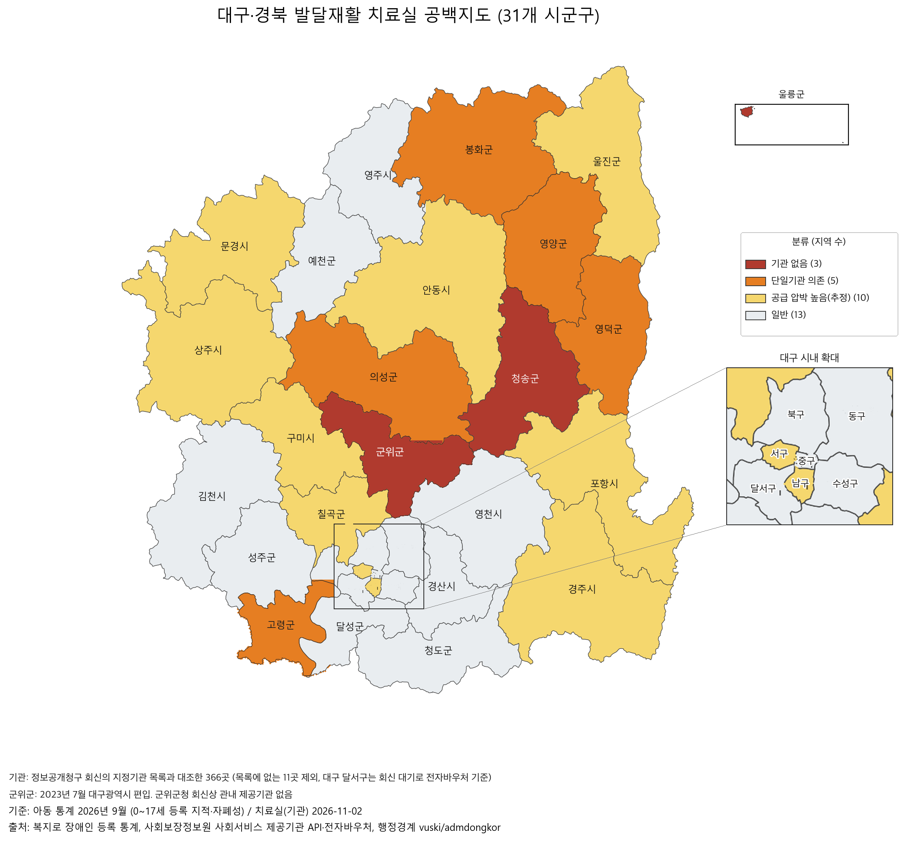

# 발달재활 치료실 내비

발달장애 가정을 위한 AI 발달재활 치료실 찾기 도우미 · **팀 사각지능**

- 🔗 **시연 앱**: https://attzno7s29ztwv8xtappe32.streamlit.app/
- ▶️ **시연 동영상**: https://youtu.be/kqnbtq0dSrQ

---

## 프로젝트 설명

- **한 줄 소개**: 부모가 아이 상황을 글로 쓰면 AI가 조건을 뽑아, 대구·경북의 실제 발달재활 바우처 치료실 중 맞는 곳 3곳을 비교해 주는 서비스
- **부모용 기능**
  - 자유 글 입력 → AI가 나이·치료 영역·아이 특성·가능 시간·지역 5가지 조건 추출
  - 실제 지정기관만 후보로 추천 (가까운 순, 지도에 번호로 표시)
  - 정보마다 `[확인됨]`·`[추정]`·`[확인 필요]` 표시, 자료에 없는 정보는 지어내지 않음
  - 확인이 필요한 내용은 기관별 전화 확인 질문으로 변환
- **구청용 기능**: 같은 데이터로 만든 31개 시군구 치료실 공백 지도
- **기술**: Python, pandas, Streamlit, Folium(지도), OpenAI API(조건 추출·설명), 카카오 로컬 API(주소 → 좌표 변환)

## 주제

**발달재활 바우처 치료실 탐색과 지역 공백 분석**

- **발달재활 바우처**: 18세 미만 장애아동의 언어·놀이·감각 치료비를 월 18만~26만 원 지원하는 정부 이용권
- **대상 지역**: 대구·경북 31개 시군구, 지정 제공기관 366곳

## 주제 선택 이유

- **고를 정보가 없음**
  - 전자바우처에는 기관명·주소·전화·품질평가만 있고, 치료 분야와 운영 요일·시간은 없음
  - 한국사회보장정보원 정보공개 회신: "전자바우처 시스템에서 생산·접수하지 않는 정보" (2026.11.10)
  - 부모는 기관마다 전화해 확인하고, 맞지 않으면 처음부터 다시 찾는 상황
- **수요 증가**: 대구·경북 0~17세 발달장애(지적·자폐성) 등록 아동 2020년 5,121명 → 2026년 7,172명 (+40%)
  - 자폐성 장애는 1,146명 → 2,817명으로 약 2.5배
- **지역 격차**: 31개 시군구 중 치료실이 없거나 1곳뿐인 지역 8곳

## 데이터 분석 내용

### 사용 데이터

| 데이터 | 제공기관 | 받은 방법 | 쓴 곳 |
| --- | --- | --- | --- |
| 사회서비스 제공기관 정보 검색_GW | 한국사회보장정보원 | 공공데이터포털 오픈API | 기관 376곳 주소·전화·기관ID |
| 전자바우처 제공기관 자료 (발달재활, 대구·경북) | 사회서비스 전자바우처 | 사이트 엑셀 다운로드 | 377곳 품질등급·이용자·제공인력 |
| 장애인등록 장애유형별 연령별 장애인수 | 한국사회보장정보원 (복지로 통계) | 통계 파일 | 시군구별 아동 수, 2013~2026 월별 추이 |
| 사회서비스 공통코드 조회 | 한국사회보장정보원 | 오픈API | 사업·시도 코드 |
| 정보공개청구 회신 12곳 | 보건복지부, 한국사회보장정보원, 경상북도, 대구 구·군 | 정보공개포털 청구 | 지정기관 목록 대조, 서비스 영역 235곳, 경북 운영시간 168곳 |

- 웹 크롤링 없이 오픈API·공식 통계·정보공개청구로만 수집

### 분석 방법

1. **기관 확정**: API·전자바우처 목록 377곳을 정보공개청구 지정기관 목록과 대조 → 목록에 없는 11곳 제외, **366곳** 확정
2. **시군구 결합**: 아동 수(2026년 9월)와 기관 수·이용자 수·제공인력 수를 31개 시군구로 결합
3. **지표 계산**
   - 기관 1곳당 아동 수 = 아동 수 ÷ 기관 수
   - 제공인력 1명당 이용자 수 = 이용자 수 ÷ 제공인력 수
4. **공백 분류** (팀 분석 기준, 국가 공식 기준 아님)
   - **기관 없음**: 기관 0곳
   - **단일기관 의존**: 기관 1곳
   - **공급 압박 높음(추정)**: 기관 2곳 이상인 23개 지역에서 두 지표 중 하나가 상위 25%
   - **일반**: 그 밖의 지역
5. **회신 반영**: 지자체가 회신한 실제 서비스 영역(235곳)과 경북 운영 요일·시간(168곳)을 앱에서 `[확인됨]`으로 표시

### 분석 결과

| 분류 | 지역 수 | 지역 |
| --- | ---: | --- |
| 기관 없음 | 3 | 경북 청송·울릉, 대구 군위 |
| 단일기관 의존 | 5 | 봉화·영덕·의성·고령·영양 |
| 공급 압박 높음(추정) | 10 | |
| 일반 | 13 | |

- 공급 압박 지역에 아동의 **43.0%**가 살지만 기관은 **35.2%**
- 기관 1곳당 아동: 대구 16.8명, 경북 22.9명, 경북 의성 53명 (대구의 3배 이상)
- 아동 수 추이: 2014~2019년 정체(약 5,000명) → 2020년 이후 급증, 2026년 7,172명

### 한계와 개선할 점

- 치료실별 대기 정보 없음 (회신의 대기자는 바우처 예산 대기자) → 기관이 직접 입력하는 칸 제안
- 운영시간은 경북만 확보, 대구는 미확보 → 지자체 자료 표준화·추가 청구
- 거리는 동·시군구 중심 직선거리 → 지도 API로 실제 이동시간 계산
- 등록 통계에 포함되지 않는 미등록 영유아 수요 (9세 미만은 등록 없이 의뢰서로 이용 가능)

## 프로젝트 자료

| 자료 | 파일 |
| --- | --- |
| 프로젝트 계획서 (아이디어 제안서) | [docs/proposal.hwp](docs/proposal.hwp) |
| 발표자료 | [docs/final_presentation.pptx](docs/final_presentation.pptx) |
| 시연 동영상 | https://youtu.be/kqnbtq0dSrQ |
| 시연 앱 | https://attzno7s29ztwv8xtappe32.streamlit.app/ |

## 팀원 소개

| 역할 | 이름 | 맡은 일 |
| --- | --- | --- |
| A · 데이터 | 장동우 | 기관 목록 검증, 31개 시군구 공백표, 수치·출처 정리, 정보공개청구 회신 반영 |
| B · AI·앱 | 안수환 | AI 프롬프트 시험(3개 AI 비교·채점), 기존 서비스 차별성 분석, Streamlit 앱 개발 |
| C · 지도·분석 | 추교현 | 31개 시군구 공백지도, 아동 수 추이 분석, 실행방안·기대효과 근거 |
| D · 팀장 | 마성혁 | 기획, 정보공개청구, 제안서 통합·제출, 발표 |
